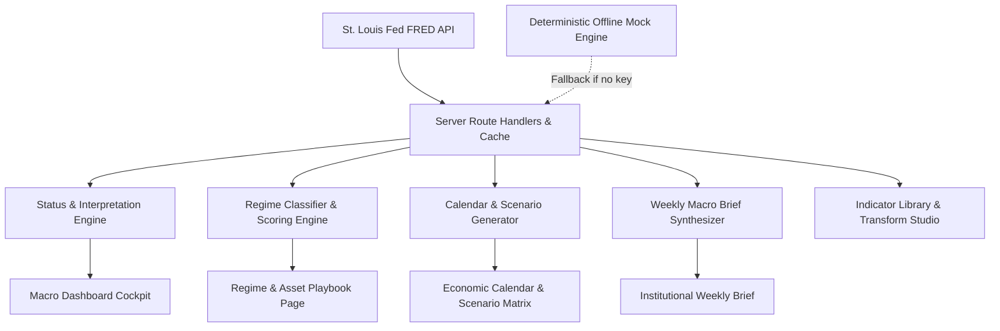

# US Macro Radar

An institutional-grade, personal U.S. macroeconomic radar dashboard and decision-support cockpit built with **Next.js App Router**, **TypeScript**, **Tailwind CSS**, **Recharts**, **SWR**, **Zod**, and the **St. Louis Federal Reserve Economic Data (FRED) API**.

---

## Table of Contents

1. [About US Macro Radar](#about-us-macro-radar)
   - [Overview & Purpose](#overview--purpose)
   - [The Problem It Solves](#the-problem-it-solves)
   - [The Analytical Framework (Five Core Pillars)](#the-analytical-framework-five-core-pillars)
   - [Core Design & Operating Principles](#core-design--operating-principles)
2. [Feature Explanations: What Is It & What Does It Do?](#feature-explanations-what-is-it--what-does-it-do)
   - [1. Macro Executive Cockpit & Five Category Panels](#1-macro-executive-cockpit--five-category-panels)
   - [2. Real-Time Metric Cards & Status Engine](#2-real-time-metric-cards--status-engine)
   - [3. Interactive Time-Series & Deep-Dive Charting](#3-interactive-time-series--deep-dive-charting)
   - [4. Macroeconomic Regime Classification Engine (The 4 Quadrants)](#4-macroeconomic-regime-classification-engine-the-4-quadrants)
   - [5. Cross-Asset Allocation Playbook & Falsification Triggers](#5-cross-asset-allocation-playbook--falsification-triggers)
   - [6. Economic Calendar & Conditional Scenario Matrix](#6-economic-calendar--conditional-scenario-matrix)
   - [7. Indicator Library & Mathematical Transformation Studio](#7-indicator-library--mathematical-transformation-studio)
   - [8. Automated Institutional Weekly Macro Brief](#8-automated-institutional-weekly-macro-brief)
   - [9. Dual-Mode Data Engine (Live FRED API + Offline Fallback)](#9-dual-mode-data-engine-live-fred-api--offline-fallback)
   - [10. Dark-Mode Institutional Terminal UI / UX](#10-dark-mode-institutional-terminal-ui--ux)
3. [The 24 Tracked FRED Macroeconomic Series](#the-24-tracked-fred-macroeconomic-series)
4. [Architecture & Technology Stack](#architecture--technology-stack)
5. [Getting Started & Local Setup](#getting-started--local-setup)
6. [Server Route Handlers & API Contract](#server-route-handlers--api-contract)
7. [Testing Suite](#testing-suite)
8. [Deployment Guide](#deployment-guide)
9. [License & Disclaimers](#license--disclaimers)

---

## About US Macro Radar

### Overview & Purpose
**US Macro Radar** is a real-time, institutional-grade macroeconomic dashboard designed to bridge the gap between complex Federal Reserve economic releases and actionable cross-asset market intelligence. It serves as an analytical cockpit for macro analysts, portfolio managers, traders, and individual investors seeking to evaluate the direction of the United States economy without noise or narrative bias.

Rather than relying on sensational financial news headlines or static spreadsheets, US Macro Radar connects directly to the **Federal Reserve Bank of St. Louis (FRED) API**, ingesting 24 foundational economic time-series across Growth, Inflation, Employment, Monetary Policy, and Financial Conditions. It continuously processes these data points through quantitative scoring algorithms, dynamic status heuristics, and scenario models to synthesize a coherent, data-driven view of where the economy stands and where markets may head next.

### The Problem It Solves
1. **Information Overload & Noise**: Financial media routinely fixates on individual, volatile monthly data prints (e.g., a single nonfarm payrolls surprise) without placing them in the context of broader multi-quarter business cycle trends.
2. **Fragmented Data Sources**: Key macroeconomic indicators are published across multiple disparate government agencies (Bureau of Labor Statistics, Bureau of Economic Analysis, Federal Reserve Board, Department of Labor, Chicago Fed). Gathering and aligning these time series manually is tedious and error-prone.
3. **Lack of Cross-Asset Synthesis**: Knowing that CPI came in 10 bps above consensus is insufficient; investors must understand what that print implies across Treasury yields, the yield curve, the U.S. Dollar, and equity risk premia.
4. **Binary Thinking vs. Probabilistic Scenarios**: Traditional economic calendars show simple "forecast vs. actual" figures. They fail to prepare market participants for conditional branching scenarios (e.g., *"If headline drops below 2.8% while core remains sticky, how will rates and equities react?"*).

### The Analytical Framework (Five Core Pillars)
US Macro Radar organizes the macro universe into five fundamental questions:

| Pillar | Fundamental Question | Focus Indicators |
| :--- | :--- | :--- |
| **Growth & Output** | *Is U.S. economic growth accelerating or slowing?* | Real GDP (`GDPC1`), Retail Sales (`RSAFS`), Industrial Production (`INDPRO`), NY Fed Weekly Economic Index (`WEI`). |
| **Inflation & Prices** | *Is inflation cooling toward target or re-accelerating?* | Headline CPI (`CPIAUCSL`), Core CPI (`CPILFESL`), Headline PCE (`PCEPI`), Core PCE (`PCEPILFE`), 5Y Breakeven Inflation (`T5YIE`). |
| **Labor Market** | *Is the labor market loosening or remaining historically tight?* | Unemployment Rate (`UNRATE`), Nonfarm Payrolls (`PAYEMS`), Jobless Claims (`ICSA`), JOLTS Job Openings (`JTSJOL`), Wage Growth (`CES0500000003`). |
| **Monetary Policy & Rates** | *Is monetary policy restrictive, neutral, or actively easing?* | Fed Funds Rate (`DFF`), 2Y Treasury Yield (`DGS2`), 10Y Treasury Yield (`DGS10`), 10Y-2Y Spread (`T10Y2Y`), 10Y-3M Spread (`T10Y3M`). |
| **Financial Conditions & Risk** | *Are financial conditions tightening or supportive of risk?* | Chicago Fed NFCI (`NFCI`), High Yield Credit Spread (`BAMLH0A0HYM2`), Investment Grade Spread (`BAMLC0O0CM`), Dollar Index (`DTWEXBGS`), VIX (`VIXCLS`). |

### Core Design & Operating Principles
- **Signal Over Noise**: Highlighting rate-of-change, multi-month trends, and structural thresholds rather than intraday tick noise.
- **Probabilistic & Falsifiable**: Every regime classification includes explicit *falsification triggers*—specific indicator levels that would invalidate the current thesis.
- **Zero API Key Leakage**: All FRED queries are executed securely through Next.js server route handlers with HTTP-level caching. The client browser never receives or exposes the secret API key.
- **Zero-Config Deterministic Fallback**: The dashboard operates seamlessly out-of-the-box. If no FRED API key is supplied, it automatically activates a deterministic offline mode using realistic historical data, allowing instant testing and demonstration.

---

## Feature Explanations: What Is It & What Does It Do?

Every feature in US Macro Radar is designed around an institutional workflow:



---

### 1. Macro Executive Cockpit & Five Category Panels
- **Route**: `/` (Main Dashboard)

#### What is it?
The Macro Executive Cockpit is the application's central command center. It organizes 24 macroeconomic metrics into five distinct thematic panels (*Growth*, *Inflation*, *Labor*, *Policy & Rates*, and *Financial Conditions*), topped by an executive status bar that presents the current economic regime and market direction assessment.

#### What does it do?
- **Answers the 5 Macro Questions**: Each panel explicitly displays the fundamental macroeconomic question it answers, along with an aggregated health status (`IMPROVING`, `STABLE`, or `DETERIORATING`) and a synthesized one-sentence narrative summary.
- **Displays Metric Cards in a Responsive Grid**: Renders individual metric cards for each series (3 columns on desktop, 2 on tablet, 1 on mobile).
- **Synchronizes with the Historical Chart**: Clicking any metric card instantly updates the interactive deep-dive chart at the top of the page to reflect that indicator's historical trajectory.
- **Surfaces Regime Context**: Displays the active macro regime badge, confidence level, growth state, and market assessment at the very top of the page with direct jump-links to deep-dive pages.

---

### 2. Real-Time Metric Cards & Status Engine
- **Component**: `src/components/ui/MetricCard.tsx`
- **Engine**: `src/lib/macro/status-engine.ts`

#### What is it?
A specialized UI component and evaluation engine that renders economic indicators with visual status cues, directional context, and automated financial interpretations.

#### What does it do?
- **Directional Health Evaluation**: Automatically analyzes whether the latest reading is `Improving`, `Stable`, or `Deteriorating` based on configured rules:
  - *Growth/Labor*: Expanding numbers are generally improving; rising unemployment or claims are deteriorating.
  - *Inflation*: Cooling prints toward 2.0% are improving; accelerating prints are deteriorating.
  - *Financial Conditions & Volatility*: Chicago Fed NFCI below 0 and VIX below 18 are improving; spikes are deteriorating.
  - *Yield Curve Spreads*: Normal positive slopes are improving/stable; negative slopes trigger inversion warnings.
- **Yield Curve Inversion Warning Badges**: Specifically detects when the 10Y-2Y (`T10Y2Y`) or 10Y-3M (`T10Y3M`) yield curve spread is inverted (< 0.00%), displaying an amber warning alert (`Yield Curve Inverted: Historical Recession Warning`).
- **Displays Precision Numbers & Changes**: Displays the latest value with appropriate units (`%`, `bps`, `Index`, `Billions $`, `Thousands`), prior period value, period-over-period delta, percentage change, and Year-over-Year (YoY) change.
- **Embedded SVG Sparkline**: Renders a lightweight, color-coded inline sparkline of the last 12-24 observations for immediate visual trend context.
- **Plain-English Automated Interpretation**: Generates a dynamic, analyst-style interpretation sentence for the metric reading (e.g., *"Core inflation decelerated toward target, supporting Fed rate cut path"*).

---

### 3. Interactive Time-Series & Deep-Dive Charting
- **Component**: `src/components/ui/TimeSeriesChart.tsx`

#### What is it?
A responsive SVG-based data visualization component built on top of Recharts, tailored specifically for macroeconomic time-series data.

#### What does it do?
- **Dynamic Series Binding**: Binds seamlessly to any selected indicator from the dashboard or indicator library, rendering historical date/value coordinates.
- **Multi-Year Range Selectors**: Provides one-click lookback toggles (`1Y`, `3Y`, `5Y`, and `MAX`), automatically filtering the observation dataset.
- **Benchmark & Zero Reference Lines**: Draws horizontal dashed reference lines for critical economic thresholds (e.g., 0.00% for yield curve inversion, 2.0% for Fed inflation target, 0.00 for NFCI financial conditions).
- **Inversion & Risk Visual Cues**: Switches area gradient fills and line strokes from institutional blue to warning rose/red when a monitored spread drops below its critical benchmark.
- **Custom Terminal Tooltips**: Displays an institutional dark-mode tooltip showing the exact calendar date, formatted value, unit of measure, and change delta on cursor hover.

---

### 4. Macroeconomic Regime Classification Engine (The 4 Quadrants)
- **Route**: `/regime`
- **Engine**: `src/lib/macro/regime-engine.ts`

#### What is it?
A quantitative macroeconomic momentum classifier that maps the U.S. economy into one of four business cycle quadrants based on growth and inflation vectors.

#### What does it do?
- **Calculates Continuous Momentum Scores**:
  - **Growth Score** ($-100$ to $+100$): Weighted aggregation of Real GDP, Retail Sales YoY, Industrial Production YoY, NY Fed Weekly Economic Index, and Unemployment rate changes.
  - **Inflation Score** ($-100$ to $+100$): Weighted aggregation of Headline CPI, Core CPI, Core PCE Price Index, and 5-Year Breakeven inflation rates.
- **Classifies the 4 Regimes**:
  1. **Goldilocks** (Growth $\ge 0$, Inflation $\le 0$): Above-trend or stable growth combined with disinflation. Historically the most favorable backdrop for equities, high-yield credit, and multiple expansion.
  2. **Reflation** (Growth $\ge 0$, Inflation $> 0$): Robust growth accompanied by accelerating price pressures. Favorable for commodities, cyclicals, and energy; challenging for long-duration fixed income.
  3. **Disinflationary Slowdown** (Growth $< 0$, Inflation $\le 0$): Decelerating economic output with cooling price pressures. Bullish for sovereign duration (Treasuries rally, yields fall); challenging for corporate earnings and equities.
  4. **Stagflation** (Growth $< 0$, Inflation $> 0$): Contracting economic activity paired with stubborn or rising inflation. Highly hostile for classic 60/40 portfolios; cash, commodities, and real assets outperform.
- **Confidence Scoring**: Computes a dynamic confidence percentage (0-100%) and level (`High`, `Medium`, `Low`) based on indicator consensus and distance from quadrant boundaries.
- **Tracks Regime Changes**: Compares the current score against historical baseline to publish a *"What Changed Since Last Update"* summary explaining shifts in underlying data.

---

### 5. Cross-Asset Allocation Playbook & Falsification Triggers
- **Route**: `/regime` (Asset Playbook & Falsification Sections)

#### What is it?
An institutional allocation guide that translates the active macroeconomic regime into tactical positioning stances across major asset classes, accompanied by a rigorous scientific checklist of falsification conditions.

#### What does it do?
- **Asset Class Stances**: Recommends directional positioning (`Bullish / Overweight`, `Neutral`, or `Bearish / Underweight`) across six asset classes:
  - *Equities* (Growth vs. Value, Cyclicals vs. Defensives)
  - *Treasuries & Duration* (Front-end vs. Long-end yields)
  - *Corporate Credit* (Investment Grade and High Yield spreads)
  - *Commodities* (Energy, Industrial Metals, Gold)
  - *Cash & Short-Term Paper* (Liquidity preservation, risk-free carry)
  - *U.S. Dollar* (Broad trade-weighted FX momentum)
- **Supporting vs. Contradictory Evidence Matrix**: Explicitly lists which underlying economic series confirm the active regime and which series diverge or present contradictory signals.
- **Falsification Triggers**: Outlines precise empirical conditions that would invalidate the current macro thesis (e.g., *"Core CPI 3-month annualized re-accelerating above 3.5%"* or *"Nonfarm payrolls turning negative (< 0k) accompanied by UNRATE rising > 0.5% from 12-month low"*), preventing recency bias and thesis lock-in.

---

### 6. Economic Calendar & Conditional Scenario Matrix
- **Route**: `/calendar`
- **Data & Logic**: `src/lib/macro/calendar-data.ts`

#### What is it?
A forward-looking economic calendar that goes beyond simple dates and consensus estimates by modeling conditional scenario trees for high-impact releases.

#### What does it do?
- **Weekly Release Scheduling**: Segregates upcoming major U.S. releases into `This Week` and `Next Week` views (CPI, Core PCE, Nonfarm Payrolls, Retail Sales, FOMC Rate Decisions, ISM PMIs, Initial Jobless Claims).
- **Release Metadata**: Shows exact date, Eastern Time (ET), reporting agency, consensus forecast, and prior reading.
- **Multi-Filter Navigation**: Allows instant filtering for `Major Events Only` and filtering by impacted asset class (`Equities`, `Treasuries`, `US Dollar`, `Commodities`).
- **Conditional Scenario Trees (Bullish / Base / Bearish)**:
  - **Probability Weighting**: Assigns estimated probabilities to each potential outcome.
  - **Threshold Criteria**: Defines the numerical trigger band (e.g., *Below 2.5%*, *2.5% - 2.8%*, *Above 2.8%*).
  - **Cross-Asset Directional Arrows**: Maps expected immediate reactions for Equities, 10-Year Treasury Yields, and the U.S. Dollar.
  - **Fed Policy Implication**: Explains how the FOMC is likely to interpret and act on the outcome.
  - **Why It Matters & Key Risks**: Highlights consensus positioning vulnerabilities and asymmetric risks.

---

### 7. Indicator Library & Mathematical Transformation Studio
- **Route**: `/indicators`
- **Registry**: `src/config/fred-series.ts`

#### What is it?
A comprehensive directory and exploratory workbench covering all 24 FRED economic indicators with real-time mathematical transformation capabilities.

#### What does it do?
- **Searchable Indicator Registry**: Instant keyword search across series titles, series IDs, and descriptions, combined with category filters (*Growth*, *Inflation*, *Labor*, *Policy & Rates*, *Financial Conditions*).
- **Mathematical Transformation Toggles**:
  - `Level (lin)`: Displays the raw reported observation level (e.g., GDP in Billions, Unemployment in %).
  - `Period Change (chg)`: Calculates period-over-period absolute delta ($Value_t - Value_{t-1}$).
  - `YoY % Change (pc1)`: Computes Year-over-Year percent change relative to the same period 12 months prior ($((Value_t / Value_{t-12}) - 1) \times 100$).
- **Statistical Extremes & 52-Week Ranges**: Displays 52-week historical minimum, 52-week maximum, latest observation, and sample observation count.
- **Deep Metadata & FRED Links**: Provides direct links to the official St. Louis Fed FRED series page, reporting frequency, source agency, and an institutional explanation of why the metric matters to monetary policy and financial assets.

---

### 8. Automated Institutional Weekly Macro Brief
- **Route**: `/brief`
- **Generator**: `src/lib/macro/brief-generator.ts`

#### What is it?
An automated research memo generator that synthesizes the entire macroeconomic state into a structured, executive-ready research briefing note.

#### What does it do?
- **Executive Synthesis**: Combines the latest observations across all five panels into a clean, top-down narrative briefing note formatted for investment committees and senior decision-makers.
- **Four Core Brief Sections**:
  1. *What Happened Last Week*: Retrospective breakdown of data releases, economic surprises, and moves in Treasury yields, equities, and currencies.
  2. *What Matters This Week*: Forward-looking catalyst preview detailing upcoming data releases, Fed speaking engagements, and consensus expectations.
  3. *Scenario Probabilities*: Explicit distribution of probabilities across Base Case, Bullish Growth / Soft Landing, and Stagflationary / Bearish tail risks.
  4. *Key Risks & Asymmetric Payoffs*: Identification of market mispricings and unhedged macro vulnerabilities.
- **Print & PDF Export Engine**: Includes dedicated print stylesheets and a one-click `Print / PDF` export button for generating clean physical or digital PDF reports with dark/light print optimization.

---

### 9. Dual-Mode Data Engine (Live FRED API + Offline Fallback)
- **Module**: `src/lib/fred/client.ts`
- **Mock Registry**: `src/lib/fred/mock-data.ts`

#### What is it?
A resilient data ingestion layer that manages communication with the St. Louis Fed FRED API, server caching, and deterministic offline fallbacks.

#### What does it do?
- **Server-Side API Proxying**: Executes all FRED queries inside Next.js server route handlers. The secret `FRED_API_KEY` is never transmitted to the browser client.
- **Next.js Data Caching & ISR**: Implements time-based data revalidation (`next: { revalidate: 3600 }`) and HTTP `Cache-Control` response headers to minimize API consumption and respect FRED rate limits.
- **Deterministic Offline Fallback**: If `FRED_API_KEY` is missing or placeholder (`your_fred_api_key_here`), the engine automatically routes to realistic, internally consistent mock time-series data without throwing runtime exceptions.
- **Visual Mode Indicator**: The dashboard header visually indicates whether live FRED data (`Connected (FRED Live API)`) or fallback data (`Connected (Demo Fallback Mode)`) is currently active.

---

### 10. Dark-Mode Institutional Terminal UI / UX
- **Styles**: `src/app/globals.css`
- **Header**: `src/components/layout/Header.tsx`

#### What is it?
A user interface design system inspired by professional financial terminals (Bloomberg, Koyfin, FactSet), optimized for prolonged analytical sessions.

#### What does it do?
- **High-Contrast Dark Palette**: Deep black (`#000000`) and subtle zinc surfaces (`#09090b` to `#18181b`) with purposeful accent colors (emerald for growth/easing, blue for policy/neutral, rose/amber for contraction/tightening/inversion).
- **Responsive Layout**: Seamlessly transitions from multi-column institutional desktop displays to single-column tablet and mobile views.
- **Skeleton Loading States**: Renders smooth animated skeleton placeholders (`src/components/ui/Skeleton.tsx`) while time-series data and regime scores are being calculated, eliminating layout shifts.
- **Manual & SWR Revalidation**: Features a global header refresh button with a spinning animation, triggering an immediate background revalidation across all active SWR caches.

---

## The 24 Tracked FRED Macroeconomic Series

US Macro Radar tracks 24 official series, cataloged below by category, FRED identifier, reporting agency, and economic rationale:

```
Growth & Output
├── GDPC1        Real Gross Domestic Product (BEA)
├── RSAFS        Advance Real Retail & Food Services Sales (Census)
├── INDPRO       Industrial Production Index (FRB)
└── WEI          Weekly Economic Index (NY Fed)

Inflation & Prices
├── CPIAUCSL     Consumer Price Index: All Urban Consumers (BLS)
├── CPILFESL     Core CPI: All Items Less Food & Energy (BLS)
├── PCEPI        Personal Consumption Expenditures: Price Index (BEA)
├── PCEPILFE     Core PCE Price Index [Fed Primary Target] (BEA)
└── T5YIE        5-Year Breakeven Inflation Rate (St. Louis Fed)

Labor Market
├── UNRATE       Civilian Unemployment Rate (BLS)
├── PAYEMS       Total Nonfarm Payroll Employment (BLS)
├── ICSA         Initial Jobless Claims (DOL)
├── JTSJOL       Job Openings: Total Nonfarm [JOLTS] (BLS)
└── CES0500000003 Average Hourly Earnings of All Employees (BLS)

Monetary Policy & Rates
├── DFF          Federal Funds Effective Rate (NY Fed)
├── DFEDTARU     Federal Funds Target Range - Upper Limit (FRB)
├── DGS2         2-Year Treasury Constant Maturity Yield (FRB)
├── DGS10        10-Year Treasury Constant Maturity Yield (FRB)
├── T10Y2Y       10-Year Minus 2-Year Treasury Spread [Curve Inversion] (FRB)
└── T10Y3M       10-Year Minus 3-Month Treasury Spread [Recession Gauge] (FRB)

Financial Conditions & Risk
├── NFCI         Chicago Fed National Financial Conditions Index (Chicago Fed)
├── BAMLH0A0HYM2 ICE BofA US High Yield Index Option-Adjusted Spread (ICE)
├── BAMLC0O0CM   ICE BofA US Corporate Index OAS [Investment Grade] (ICE)
├── DTWEXBGS     Trade-Weighted U.S. Dollar Index: Broad (FRB)
└── VIXCLS       CBOE Volatility Index [VIX] (CBOE)
```

---

## Architecture & Technology Stack

| Technology | Role | Implementation Details |
| :--- | :--- | :--- |
| **Next.js 15 (App Router)** | Full-Stack Web Framework | Server Route Handlers, React Server Components, ISR data caching, Turbopack bundling. |
| **TypeScript** | Type Safety & Domain Modeling | Strict typing across all FRED schemas, API contracts, regime coordinates, and calendar structures. |
| **Tailwind CSS v4** | Design System & Styling | Modern CSS utility layer with custom financial terminal dark theme and responsive flex/grid layouts. |
| **Recharts** | Data Visualization | Responsive SVG charts with linear gradients, custom tooltips, benchmark reference lines, and zero curves. |
| **SWR** | Client-side Data Fetching | Client cache deduplication, background revalidation on interval, optimistic mutations, zero token exposure. |
| **Zod** | Validation & Parsing | Server-side validation of FRED API JSON responses and query parameters. |
| **date-fns** | Temporal Calculations | Calendar week clustering (`isSameWeek`, `startOfWeek`, `addWeeks`), timezone normalization, and format strings. |
| **Vitest** | Unit Testing Suite | Automated test verification of continuous scoring math, status heuristics, and regime classification boundaries. |
| **Lucide React** | Iconography | Visual status indicators, directional trends, navigation icons, and alert badges. |

---

## Getting Started & Local Setup

### 1. Prerequisites
- **Node.js**: Version 18.17 or higher (Node 20+ recommended).
- **Package Manager**: `npm`, `pnpm`, or `yarn`.

### 2. Clone and Install Dependencies
```bash
git clone https://github.com/your-username/macro_analyst.git
cd macro_analyst
npm install
```

### 3. Environment Configuration
Create a local environment file by copying the example template:
```bash
cp .env.example .env.local
```

Open `.env.local` and add your free St. Louis Fed FRED API key:
```env
# Get your free key at: https://fred.stlouisfed.org/docs/api/api_key.html
FRED_API_KEY=your_actual_fred_api_key_here
```

> **Zero-Config Note**: If `FRED_API_KEY` is omitted or left as `your_fred_api_key_here`, US Macro Radar automatically runs in **Deterministic Offline Mode** with realistic historical series. You can build, test, and demonstrate all features immediately without registering for an API key.

### 4. Run Development Server
```bash
npm run dev
```
Navigate to [http://localhost:3000](http://localhost:3000) in your browser.

### 5. Build for Production
```bash
npm run build
npm run start
```

---

## Server Route Handlers & API Contract

All FRED requests pass through server route handlers to safeguard credentials and provide unified caching:

| Endpoint | Method | Query Parameters | Description |
| :--- | :--- | :--- | :--- |
| `/api/fred/dashboard` | `GET` | — | Aggregates all 5 category panels, calculates panel summaries, and computes active regime classification. |
| `/api/regime` | `GET` | — | Returns continuous momentum scores (growth & inflation), active quadrant, confidence metrics, asset playbooks, and falsification criteria. |
| `/api/calendar` | `GET` | — | Supplies weekly catalyst schedule, consensus forecasts, and conditional Bullish/Base/Bearish scenario trees. |
| `/api/brief` | `GET` | — | Synthesizes the automated weekly institutional macroeconomic memo. |
| `/api/fred/series/[seriesId]`| `GET` | `units`, `frequency` | Returns processed summary, history, and sparkline for a single FRED series with optional mathematical transform (`lin`, `chg`, `pc1`). |
| `/api/fred` | `GET` | `series_id`, `series_ids`, `mode` | Batch or single-series raw observation endpoint. |

---

## Testing Suite

US Macro Radar includes comprehensive unit tests covering the regime scoring mathematics, status classification heuristics, and GDP advance/preliminary/final estimate parsing.

Execute the test suite using Vitest:
```bash
npm test
```

To run tests in watch mode during development:
```bash
npm run test:watch
```

---

## Deployment Guide

### Deploying to Vercel
1. Push your repository to your Git provider (GitHub, GitLab, Bitbucket).
2. Import the project into the [Vercel Dashboard](https://vercel.com/new).
3. In **Project Settings > Environment Variables**, configure:
   - `FRED_API_KEY` = your St. Louis Fed API key.
4. Click **Deploy**. Next.js automatically sets up Edge Caching, Serverless Route Handlers, and static asset delivery.

### Self-Hosted / Docker
The application runs as a standard Node.js server:
```bash
npm run build
export PORT=3000
npm run start
```

---

## License & Disclaimers

### Analytical Disclaimer
This software is provided strictly for educational, research, and informational macroeconomic tracking purposes. It **does not constitute personalized investment advice**, financial planning, or a solicitation to buy or sell securities, commodities, currencies, or futures contracts. All scenario trees and regime classifications represent probabilistic analytical frameworks rather than guaranteed market forecasts.

### Data Attribution
Macroeconomic data is sourced via public API endpoints provided by the **Federal Reserve Bank of St. Louis (FRED)**, the **U.S. Bureau of Economic Analysis (BEA)**, the **U.S. Bureau of Labor Statistics (BLS)**, the **U.S. Department of Labor (DOL)**, and the **Federal Reserve Board of Governors**.

---
*Developed with institutional macro standards for investors, researchers, and market analysts.*
